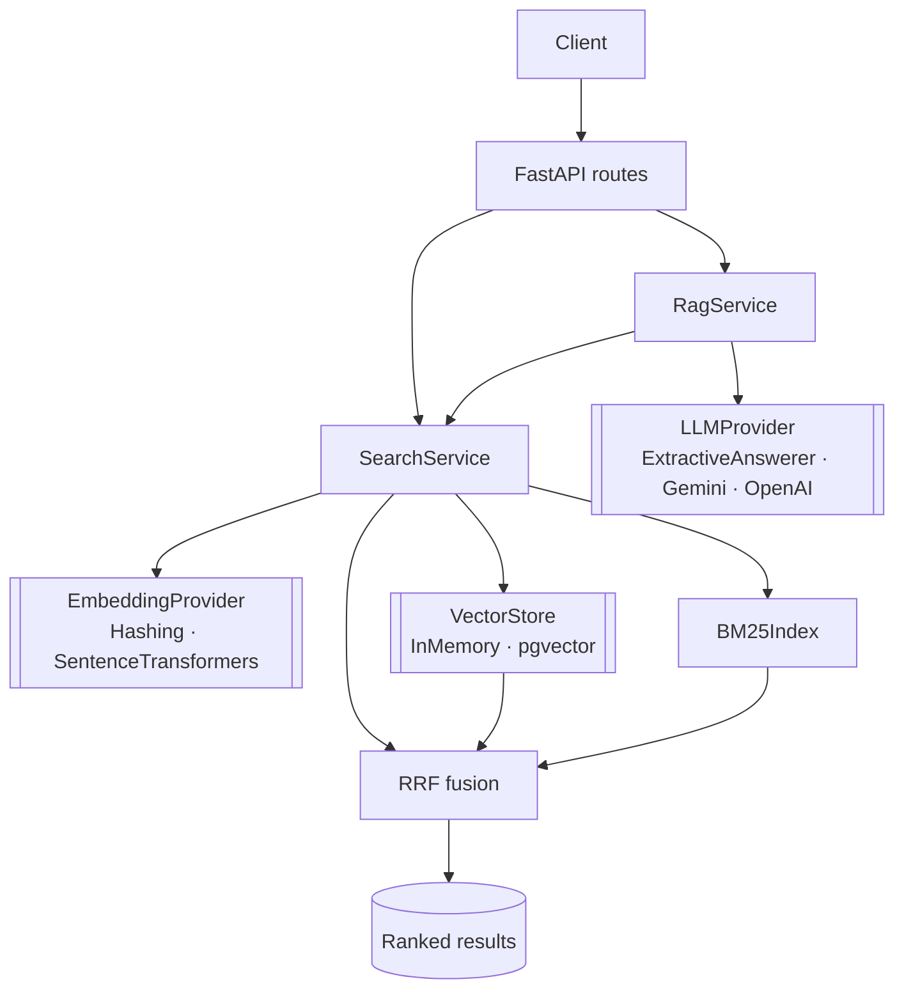

# semantic-search-service

Hybrid **keyword + vector** search and **RAG** over a document corpus, behind a
small, strongly-typed FastAPI service built with **ports and adapters** so every
piece — embedder, vector store, LLM — is swappable.

[](https://github.com/VarunGandhi12/semantic-search-service/actions/workflows/ci.yml)


> Runs **fully offline** — no model downloads, no API keys, no database — thanks
> to lightweight default adapters. Swap in `sentence-transformers`, `pgvector`,
> and a generative LLM for production, without touching the core.

---

## Why this design

Most search demos hard-wire one embedding model and one store. This one is built
the way a retrieval system survives contact with production: the engine depends
on **protocols**, and concrete implementations are chosen in one place
(`app/api/deps.py`). That means the exact same code runs on a laptop with a
hashing embedder and in production with a real model + `pgvector`.

| Port | Offline default (shipped) | Production swap (documented) |
|------|---------------------------|------------------------------|
| `EmbeddingProvider` | `HashingEmbedder` — feature-hashing, deterministic | `SentenceTransformerEmbedder` (`.[semantic]`) |
| `VectorStore` | `InMemoryVectorStore` — NumPy cosine | `pgvector` / FAISS / a managed vector DB |
| `LLMProvider` | `ExtractiveAnswerer` — returns grounded passage | Gemini / OpenAI / local model |

## Features

- 🔀 **Hybrid retrieval** — BM25 (sparse) + vector (dense), fused with **Reciprocal Rank Fusion**
- 🧮 **BM25 from scratch** — transparent Okapi implementation, no black box
- 🧭 **Vector search** — L2-normalized embeddings, cosine as a single BLAS call
- 🤖 **RAG endpoint** — retrieve-then-answer, grounded with citations
- 🔌 **Ports & adapters** — add a model/store/LLM by implementing one protocol
- 🧪 **Strongly typed** (`mypy --strict`) with **≥85% test coverage** in CI
- 🐳 **Docker**, non-root, healthcheck · 📚 **OpenAPI/Swagger** at `/docs`

## Quickstart

```bash
docker compose up --build          # → http://localhost:8000/docs
# or
pip install -e ".[dev]" && uvicorn app.main:app --reload
```

The service boots with a small bundled corpus of retrieval/NLP notes so you can
query it immediately.

## API

```bash
# Hybrid search
curl -s localhost:8000/v1/search -H 'content-type: application/json' \
  -d '{"query": "how does hybrid search combine rankings", "k": 3}' | jq

# RAG
curl -s localhost:8000/v1/ask -H 'content-type: application/json' \
  -d '{"question": "what is reciprocal rank fusion", "k": 3}' | jq

# Index your own documents
curl -s localhost:8000/v1/documents -H 'content-type: application/json' \
  -d '{"documents": [{"id": "1", "text": "…", "source": "docs"}]}' | jq
```

`/v1/search` accepts `"mode": "hybrid" | "vector" | "keyword"` so you can compare
retrievers directly.

## Architecture



Double-bracketed nodes are **protocols** with a swappable adapter behind them.

### Layout

```
app/
├── api/          # routes + composition root (deps.py)
├── domain/       # framework-free models + sample-corpus loader
├── embeddings/   # EmbeddingProvider port + hashing / sentence-transformer adapters
├── stores/       # VectorStore port + in-memory adapter
├── search/       # BM25 index, RRF fusion
├── rag/          # LLMProvider port + extractive adapter + RagService
├── schemas/      # Pydantic API contracts
├── service.py    # SearchService (index + retrieve orchestration)
└── main.py
data/corpus.json  # bundled sample corpus
tests/{unit,integration}
```

## How retrieval works

1. **Index** — each document is embedded (dense) and added to the BM25 index (sparse).
2. **Retrieve** — a query hits both retrievers; each returns a ranked candidate list.
3. **Fuse** — Reciprocal Rank Fusion merges the two *rankings* (not raw scores),
   so incompatible score scales never need reconciling. Documents both retrievers
   like rise to the top.
4. **Answer (RAG)** — the top passages become grounding context for the LLM provider.

## Testing

```bash
pytest        # unit (embedder, BM25, fusion, service) + integration (real HTTP), 85% gate
```

## Going to production

- **Real embeddings:** `pip install ".[semantic]"`, then swap `HashingEmbedder`
  for `SentenceTransformerEmbedder` in `app/api/deps.py`.
- **Persistence & scale:** implement `VectorStore` over `pgvector` or FAISS.
- **Generative answers:** implement `LLMProvider` against your model of choice.

Each is a single wiring change — the engine and tests are untouched.

## Roadmap

- [ ] pgvector `VectorStore` adapter + docker-compose Postgres profile
- [ ] Cross-encoder reranking stage
- [ ] Retrieval-quality eval harness (recall@k, MRR, nDCG) in CI
- [ ] Streaming RAG responses

## License

[MIT](./LICENSE)
